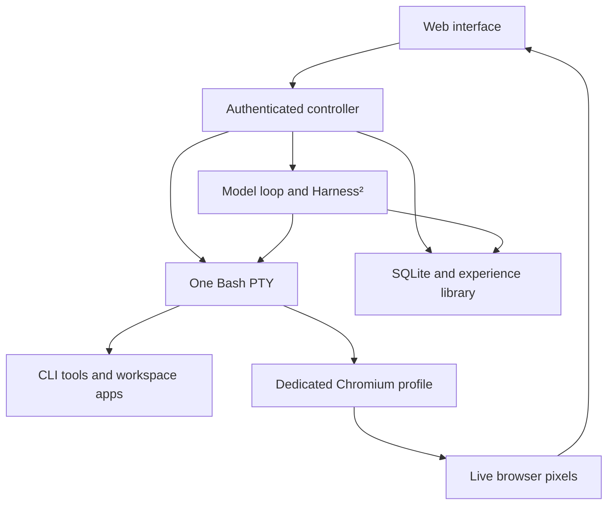

# terminal.. integration guide

## Purpose and runtime boundary

terminal.. is a web interface for one agent operating a real Linux Bash terminal.
The pixel desk, expanded terminal and recordings all use the same PTY stream.
The agent's browser is its own Chromium process inside that Linux environment.
Tasks, conversations, commands, verification results and learned procedures survive
runtime restarts. Skills are replaceable Markdown instructions.

The supplied Docker deployment is a Linux container, not a separately booted VM.
The static interface cannot execute Linux by itself: pair it with the supplied
FastAPI runtime. Hosting the interface does not host the model, terminal or browser.
One runtime represents one workspace/user; multi-user tenancy is not implemented.



The model never receives the controller's pairing token or model API key. Model
requests are controller traffic; environment actions are visible Bash commands.
The learning improver edits controller-managed instruction files through a constrained
JSON response. These instruction edits are stored by Harness² and are distinct from
commands that change the user's workspace.

## Installation and deployment

Requirements: Docker Engine with Compose (Docker Desktop with Linux containers on
Windows/macOS), outbound access to package registries on the initial build, and a
reachable Ollama or OpenAI-compatible model endpoint. There is no bundled model.
The initial image also installs Chromium and its system dependencies.

1. Clone the repository or extract the complete runtime ZIP.
2. Run `start.bat` on Windows or `bash start.sh` on Linux/macOS.
3. Open `http://localhost:8765` and paste the launcher-provided token into Runtime settings.
4. Set the model endpoint, discover available models, select one and save.
5. Start with **Recordings → App launchers → Inspect workspace**, which needs no model.
6. Open **Browser → Start browser** to launch the dedicated Chromium instance.

The launchers call `docker compose up --build -d`; they do not install Docker or a
model. Retrieve an existing token with `docker compose exec terminal cat /data/token`.

| Setting | Default | Integration meaning |
| --- | --- | --- |
| Host port `8765` | `127.0.0.1:8765` | UI, authenticated API and terminal WebSocket |
| Host port `8081` | `127.0.0.1:8081` | An app launched inside the workspace |
| `TERMINAL_DATA` | `/data` in Docker | Controller-owned persistent state, mode 0700 |
| `TERMINAL_WORKSPACE` | `/workspace` in Docker | Operator-owned work files |
| `TERMINAL_UID`, `TERMINAL_GID` | `1000` in Docker | Unprivileged shell identity |
| `TERMINAL_RUNTIME` | `docker` in image | Reported runtime type |
| `TERMINAL_ORIGINS` | empty extra list | Comma-separated exact additional UI origins |
| `PLAYWRIGHT_BROWSERS_PATH` | `/ms-playwright` in image | Chromium binaries installed at image build |
| `TERMINAL_BROWSER_DIR` | set in shell by controller | Normal or trial-specific browser profile root |

Local development defaults to `.local-state/data` and `.local-state/workspace`.
Run Python 3.12 or 3.13, install `requirements-dev.txt`, install npm dependencies,
build the UI, and run `npm run runtime`. Install Chromium with
`.venv/bin/playwright install --with-deps --only-shell chromium` when developing
browser support. Put `scripts/terminal-browser` on the shell's PATH for process-mode
use. The container already installs the command and Python module path.

To add another app port, add an explicit loopback mapping in `compose.yaml`, rebuild
if dependencies changed, and bind that app to `0.0.0.0` inside the container. For a
remote controller, terminate TLS and WebSocket connections at a trusted reverse
proxy, keep authentication enabled, and add only the intended frontend origin.
The controller is single-process: run one Uvicorn worker. Multiple workers would
create different PTYs and competing SQLite/agent state.

## Authentication and HTTP API

All `/api/*` routes below require `Authorization: Bearer <pairing-token>` except
`GET /api/health`. No real token is included in source or downloadable packages.
The frontend keeps the token in sessionStorage, the runtime URL in localStorage,
and offline task drafts in localStorage. Tokens and model keys are not included
in memory exports. Rotate the pairing token by stopping the runtime, replacing
`/data/token` with a new random value (mode 0600), restarting and pairing again.

| Method and path | Request | Result |
| --- | --- | --- |
| `GET /api/health` | none | `{status:"ok",app:"terminal.."}` |
| `GET /api/state` | none | Agent, task, message, command, memory, skill, browser, terminal and model state |
| `POST /api/tasks` | Task object below | Newly queued task |
| `POST /api/tasks/{id}/run` | `{auto_queue:false}` | Starts asynchronous execution; 409 if unavailable |
| `POST /api/tasks/{id}/cancel` | none | Removes a queued task; running tasks use Stop |
| `GET /api/tasks/{id}/learning` | none | `{config,report,trials}` including check evidence |
| `POST /api/tasks/{id}/learning` | Learning object below | Updates non-running task requirements |
| `POST /api/control` | `{action:"pause"}` | Updated control state |
| `POST /api/command` | `{command:"pwd; ls -lah"}` | Real PTY output, status, exit code, cwd and duration |
| `GET /api/commands/{id}` | none | Complete retained command summary and output |
| `POST /api/model` | Model object below | Non-secret model configuration |
| `GET /api/models` | none | `{models:[...]}` from configured provider |
| `POST /api/skills` | Skill object below | Saves or replaces an instruction module |
| `POST /api/memories` | `{title,content,kind}` | Saves a `note` or `preference` |
| `GET /api/export` | none | ZIP containing consistent SQLite backup and recorded state |
| `POST /api/browser/action` | `{action,args:[]}` | Runs the corresponding visible `terminal-browser` command |
| `GET /api/browser/frame` | none | Latest actual PNG frame, no-store; 409 when stopped |

Typical task request:

```json
{
  "goal": "Create output.txt containing hello in the provided workspace.",
  "steps": ["Create the file", "Read it back"],
  "skills": ["linux-basics"],
  "learning": {
    "enabled": true,
    "rounds": 1,
    "inputs": "",
    "checks": [
      {"name":"File content", "command":"cat output.txt", "expected":"hello", "weight":2, "timeout":30},
      {"name":"Exactly one line", "command":"test \"$(wc -l < output.txt)\" -eq 1", "expected":"", "weight":1, "timeout":30}
    ]
  }
}
```

Use `learning.enabled:false` for one execution. Verification checks are optional
for a single execution, required for repeated learning. `rounds` is 1–3; checks
are limited to 20, weights to 1–100 and timeouts to 1–180 seconds. `inputs` is an
existing directory inside the workspace, or empty for a new empty trial workspace.
The task builder exposes the same controls. Chat messages create single-run tasks
with currently enabled skills; open the task builder to configure repeated learning.

Task statuses: `queued`, `running`, `completed`, `failed`, `blocked`, `cancelled`,
`interrupted`. A model saying "finish" does not override failed verification checks.
Stopping does not delete recordings. A runtime restart marks running tasks and
commands interrupted and leaves them for review rather than resuming automatically.

Control actions: `pause`, `resume`, `stop`, `takeover`, `release`. Pause gates the
next agent action; the foreground command can still be finishing. Manual takeover
requires no command in flight. Release requires a shell prompt. A manual handover
invalidates a model action that was generated against earlier terminal state.

`/api/command` and browser manual controls reject input while the agent is active
or the terminal is in manual mode. They share the same terminal lock as agent work.
For interactive programs, use takeover plus the terminal WebSocket.

Common errors: 401 means pairing failed; 404 means a record is absent; 409 means
control or runtime state prevents the operation; 422 means request validation
failed; model discovery can return 502. Clients should show actual errors and
never manufacture successful task state. HTTP task creation is not idempotent:
a client retry after an uncertain network response can create another task.

## Terminal WebSocket and faithful display

Connect to `ws://localhost:8765/ws/terminal` (WSS with TLS). Send the authentication
message within ten seconds; the token is not a URL query parameter:

```json
{"token":"<pairing-token>"}
```

The server sends `reset`, then the stored session events through an atomic replay
cutoff, then `synced`, then live events. Output is base64 of the original PTY bytes;
decode to bytes and pass directly to a terminal emulator. Do not parse it as HTML
or regenerate command output. The original terminal grid is 100 columns × 28 rows.
Expanding the view changes display scale, not the PTY session or grid.

```json
{"type":"reset","session_id":"..."}
{"type":"resize","cols":100,"rows":28,"seq":1,"at":"ISO timestamp"}
{"type":"output","data":"base64 bytes","seq":2,"at":"ISO timestamp"}
{"type":"synced"}
```

Other events include `shell_exit` and `resync`. On `resync`, reconnect and replay;
a slow consumer is never allowed to silently lose terminal bytes. In manual mode,
send `{"type":"input","data":"pwd\r"}` or `{"type":"interrupt"}`. Origin
validation and token authentication both apply to WebSocket clients.

Bash runs in a real PTY. Prompt metadata uses a separate inherited pipe to report
exit status and cwd, while the display receives only actual terminal bytes. Agent
commands are shell-quoted and executed using a visible `eval --` wrapper in the
persistent shell. A failed or timed-out command is not assigned exit zero. Bash
prompt functions and its extra metadata descriptor are runtime infrastructure;
skills must not replace or close them.

## Browser integration

Chromium is launched by `terminal-browser start` inside the terminal. The browser
service is separate from the model and maintains a persistent Playwright context.
The command line communicates over a user-owned Unix socket, not an exposed CDP
port. The UI displays real 1280×800 PNG screenshots captured approximately every
1.5 seconds and fetched on the next state refresh. It is a live sampled view, not
a video stream or full Linux desktop. Expand scales the same pixels.

| Command | Operation |
| --- | --- |
| `terminal-browser start` | Launch or reuse this profile's Chromium service |
| `terminal-browser open 'https://example.com'` | Navigate the active tab |
| `terminal-browser new 'about:blank'` | Open and select another tab |
| `terminal-browser snapshot` | Print the active page's accessibility content |
| `terminal-browser click '#submit'` | Click an observed CSS/text selector |
| `terminal-browser fill '#name' 'Ada'` | Fill an observed input |
| `terminal-browser type 'text'` | Insert text in the focused field |
| `terminal-browser tap 100 200` | Click viewport coordinates |
| `terminal-browser press 'Enter'` | Send a keyboard key/chord |
| `terminal-browser scroll 600` | Scroll vertically |
| `terminal-browser tabs` / `tab 0` | List tabs or choose an index |
| `terminal-browser back` / `reload` / `close` | Tab navigation and close |
| `terminal-browser screenshot` | Refresh the PNG and print its path |
| `terminal-browser status` / `stop` | Inspect state or close gracefully |

Normal profile: `/workspace/.operator-home/.terminal-browser/profile`.
Downloads are retained under that root's `downloads/`, with unique filename
prefixes. `events.jsonl` records browser operations and URLs; `frame.png` is the
latest frame only. Browser commands and snapshots also appear in the main PTY
journal and command history. Frame history/video is not retained by this version.

The profile belongs to the operator; it is not the user's personal desktop browser
and does not inherit desktop cookies. Sign in explicitly when a task needs access.
Avoid putting passwords in recorded command arguments. In manual terminal mode:

```bash
read -rs secret; terminal-browser type "$secret"; unset secret
```

Bash history records the variable expression, while `read -s` suppresses typed
secret echo. Do not enable shell tracing or print the value. The profile retains
site sessions; its cookies/downloads are workspace data and are not included in
the memory export. Browser input, browser persistence and its filesystem are
inside the container boundary; the profile is not a separate OS security boundary.

## Model adapter

Model configuration:

```json
{"provider":"ollama","base_url":"http://host.docker.internal:11434","model":"your-installed-model","api_key":null}
```

`provider` is `ollama` or `compatible`. Ollama uses `GET /api/tags` and
`POST /api/chat` with JSON output format and non-streaming responses. Compatible
providers use `GET /models` and `POST /chat/completions`; include `/v1` in the base
URL when the provider requires it. `api_key:null` keeps an existing key; an empty
string clears it. HTTPS is appropriate for remote model services. The same model
is used for solving and learning proposals. Harness² is the Google framework,
not a supplied Google model or hosted execution service.

The model returns one action object per turn:

```json
{"action":"run","command":"pwd","reason":"Inspect the workspace","timeout":60}
```

Or `{"action":"finish","summary":"...","lesson":"..."}` / 
`{"action":"blocked","summary":"..."}`. There are at most 24 actions per
rollout; default foreground timeout is 60 seconds, capped at 180. Model HTTP calls
have a 180-second timeout. The solver retains instructions and recent observations;
earlier conversation turns are explicitly marked omitted after the context bound.
The underlying recordings remain on disk. Provider usage/cost is not currently
normalized, so upstream internal ledger cost fields must not be used as billing data.

## Harness² and repeated learning

The included unmodified wheel comes from
`google-research/harness2@1cfe254e8d25b15f37048c3730134686abe60335`, version 0.1.0.
See `vendor/PROVENANCE.txt` for its checksum and Apache-2.0 license location.

`HarnessMemory` uses the real `SurfaceSpec`, tree read/write/validation and `Library`.
`LiveAdapter` implements the task/rollout boundary for the real PTY. `HTTPProposer`
provides a custom HTTP model transport for upstream `Proposer.call`; the stock
OpenCode executable is not invoked. The required `ChannelSpec` schema uses the
`opencode` discriminator as compatibility metadata, while replies identify the
actual transport as `terminal-http`. Do not interpret this as an installed OpenCode
integration or a reproduction of Google's benchmark scores.

With repeated learning enabled, the app calls upstream `run_sequential` with
`propose_workers=1` and `rollout_workers=1` to preserve one visible command stream:

1. Run `k` baseline executions (`base1` … `basek`).
2. For each of `k` rounds, Harness² proposes invariant (`inv`) and domain (`dom`)
   instruction changes and probes each in a fresh rollout.
3. Harness² composes the proposals (`c1` … `ck`) and probes the composed result.
4. Compare the final composed candidate `ck` with the highest observed baseline.
5. Retain the candidate only on a strictly higher measured score and a completed
   solver rollout. Ties, regressions and blocked candidates retain the baseline.

This is **4k actual executions plus 3k improvement stages**, not k executions.
All use the selected model. There can be additional proposal retries. Invalid
proposals fall back through upstream behavior; the report lists fallback stages.
The score is applied after recursion and is not fed into the improver's evidence.
The improver sees task instructions, recorded command trajectories and summaries.
It may replace `LongTermMEMORY.md` or existing selected skill files. The action
protocol, system instructions and guardrails remain fixed. Contexts over 300,000
characters are rejected with a recorded fallback instead of silently removing
trajectory events. This is procedural adaptation, not model-weight training.

Each execution gets a separate folder under
`/workspace/.terminal-trials/<task-id>/<attempt-id>/` and a fresh browser profile.
Optional inputs are snapshotted once, excluding `.git`, `node_modules`, `.venv`,
`__pycache__`, `.operator-home` and `.terminal-trials`. Dependencies should be
reinstalled or accessed explicitly as part of the task. Retained artifact locations
are returned in the report; files are not automatically copied over the source.

Fresh folders and profiles prevent ordinary prior-output contamination. They do
**not** clone the entire container, reset global shell variables, prevent absolute
path access, or undo remote API effects. The shell user can reach sibling folders.
Verification commands run with the same user, so checks are a functional measure,
not an adversarially secure grader. Use repeatable tasks and read-only external
checks; tasks that send messages, purchase or alter external state need a separate
idempotency/dry-run strategy before repeated mode is appropriate.

## Scores and evidence

A check passes only when its actual command completes with exit code 0 and any
required output substring is present. Output is redirected to an actual file and
read back separately; an echoed command containing the expected text cannot pass.
Checks execute in the trial's workspace and their commands appear in the terminal.

`score = 100 × sum(weights of passed checks) / sum(all check weights)`

`delta = final candidate score − highest baseline score` (percentage points).

Example: baseline 60, final candidate 85 → +25 points, candidate retained.
Baseline 80, candidate 60 → −20 points, baseline retained at 80. A tie is zero
points and retains the baseline. No checks means unmeasured (`null`), not zero.
A task with any failed required check is marked failed even when the model says
it finished. An improved partial procedure can still be retained with an explicit
"requirements remain unmet" memory note and successful command evidence.

Scores describe only these checks on these runs. They are not a general ability
rating, proof of statistical improvement, a held-out test or a calibrated confidence
estimate. Runtime, check results, command evidence and all trial scores remain
inspectable. Choosing meaningful checks is part of defining the task.

## Persistent state, retrieval and backup

`terminal-memory` is the controller volume; `terminal-workspace` is the files/browser
volume. Ordinary Compose stop/down preserves both; `down -v` removes the volumes.
SQLite uses WAL and FULL synchronization. Startup migrations add learning columns
without deleting existing task records. Retrying a task updates its displayed
summary; per-attempt Harness² folders and command recordings remain available.

| Location | Content |
| --- | --- |
| `/data/memory.sqlite3` | Tasks, messages, commands, memories, skills metadata, events, trial reports |
| `/data/sessions/*.jsonl` | Ordered raw output bytes, dimensions, lifecycle events |
| `/data/skills/*.md` | Editable skill instruction files |
| `/data/harness2/tasks/` | Baseline trees, recursive stages, contexts, trajectories and receipts |
| `/data/harness2/library/workspace/` | Adopted component trees and experience entries |
| `/data/token`, `/data/model-key` | Separate controller credentials; not exported |
| `/workspace/` | User files, normal profile, downloads and trial workspaces |

Memory retrieval uses lexical overlap plus always-eligible preferences, not an
embedding database. Procedure memories must reference completed exit-zero command
records. Recalled experiences also read the corresponding Harness² library tree,
including retained guidance for relevant selected skills. A procedure is fallible
context; the agent is instructed to verify it again.

Memory export uses SQLite's backup API and includes sessions, skills and Harness²
files. It excludes controller credentials, workspace files and browser cookies.
For a complete backup, stop the runtime and back up both Docker volumes separately.
Restore exported controller data only with the controller stopped:

```bash
docker compose stop terminal
docker compose run --rm --no-deps -v /absolute/backups:/backups:ro terminal python scripts/restore.py /backups/terminal-memory.zip /data
docker compose up -d
```

The restore utility validates paths and database integrity, saves previous state
under `/data/before-restore-*`, and preserves current token/key files. Export files
contain actual task/terminal output: handle them as private workspace records.

## Modular skills and extension points

Create or import a skill through the UI, or `POST /api/skills`:

```json
{"id":"csv-audit","name":"CSV audit","description":"Inspect and validate CSV files","body":"Use Python's csv module. Inspect headers, count rows and report malformed records. Verify the output file before finishing.","enabled":true}
```

IDs use lowercase letters, digits and hyphens. Skill bodies are Markdown, maximum
50,000 characters. Installation saves instructions; it does not install software
or execute commands. New executables belong in Dockerfile/package manifests with
their own declared dependencies. Skills must use the terminal and verify outcomes.
The task builder selects the enabled skills to load. Disabling a skill does not
remove its previous recordings or experiences.

Extension seams:

- `ModelClient`: add a model protocol while preserving secret handling and JSON action validation.
- `TerminalSession`: adapt Linux execution without fabricating output or losing replay ordering.
- `LiveAdapter` and `HTTPProposer`: adapt Harness² task/context transport; preserve its upstream method.
- `verify`: add deterministic result checks with inspectable evidence and explicit missing-data behavior.
- `browser.py`: add CLI browser capabilities; keep them on the terminal path and avoid a public debug socket.
- `Store`: add durable schema migrations; preserve evidence links and record interrupted work honestly.

This version does not include MCP tool bypasses, arbitrary plugin Python imports,
a desktop VNC session, concurrent operators, model fine-tuning or an embedding
index. These are separate extensions rather than implied features.

## Validation and integration acceptance

Run the commands in README. The included GitHub Actions workflow checks Python and
TypeScript, builds the Docker image, starts the real runtime, then exercises browser
navigation, input and profile persistence through the authenticated command path.
`scripts/smoke-runtime.py` performs the same container acceptance check without a
model. It creates only a dedicated smoke-test folder and leaves a real recording.

Before enabling an actual model for regular work, perform a single-run file task,
inspect its exit codes and checks, then perform a repeatable learning task. Verify
all four trial labels for one round, the final comparison and retained artifact
path. A real model endpoint is needed to validate model-driven behavior; offline
unit tests do not imply that a particular model reliably follows the protocol.

See README's validation section for what was actually executed during this build,
including the limits of the available build environment.
